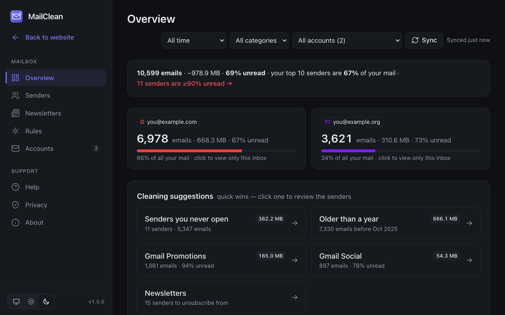
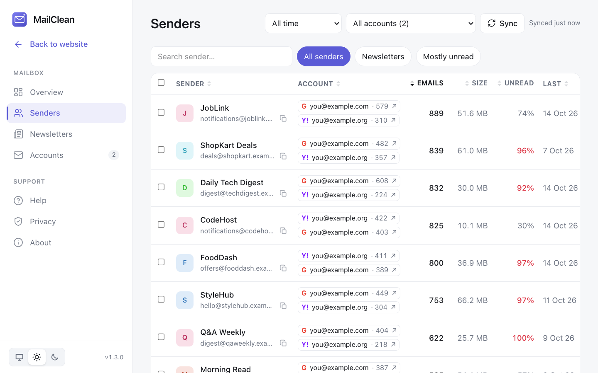
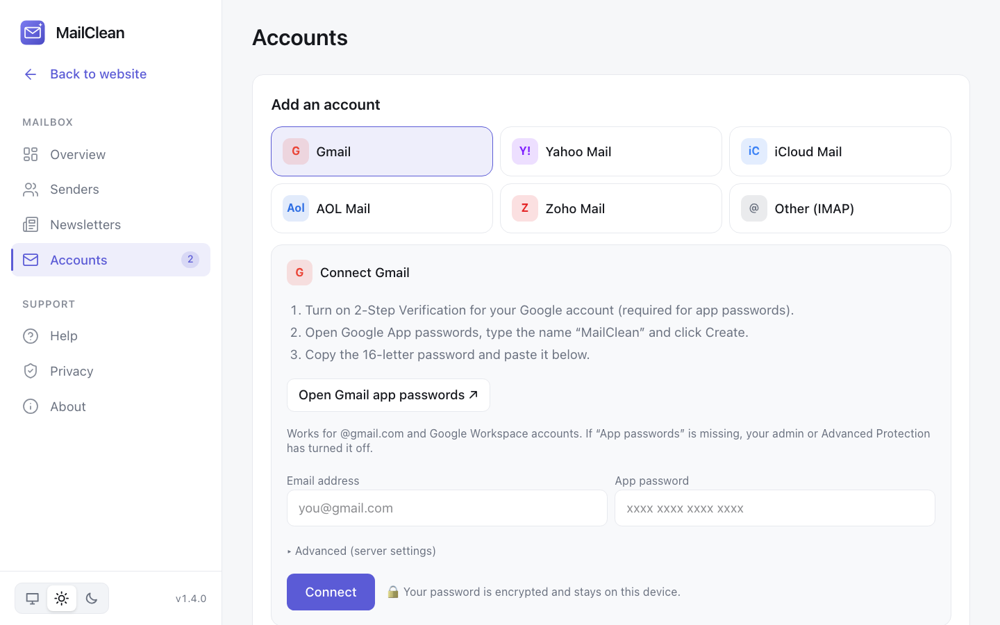

# MailClean

**Clean up every inbox in one place.** A free, open-source desktop app for **macOS, Windows and Linux** that
connects Gmail, Yahoo, iCloud, AOL, Zoho and any IMAP mailbox, shows which senders fill every inbox,
unsubscribes from newsletters and trashes or archives thousands of emails per sender in one click.

[Download](https://www.mailclean.app/download) ·
[Microsoft Store](https://apps.microsoft.com/detail/9ngqqxkrlbp1) ·
[Website](https://www.mailclean.app) ·
[Live demo](https://www.mailclean.app/demo) ·
[MIT license](LICENSE) ·
built by [@ravimehra9911](https://github.com/ravimehra9911)



| Senders, sortable by any column | Connect with an app password |
|---|---|
|  |  |

Features:

- **Sender report** by count, size and unread rate, sortable by any column, filtered by year or custom dates.
- **Bulk Trash/Archive** per sender, keeping starred and important emails and optionally the **newest N per sender**.
- **One-click unsubscribe** (RFC 8058) and a Newsletters page for unsubscribing in bulk.
- **Gmail tabs**: filter and clean by Primary, Promotions, Social, Updates, Forums and Purchases.
- **Cleaning suggestions** on the Overview page (old mail, never-opened senders, newsletters).
- **Rules**: automatic clean-ups after every sync, e.g. always trash a sender or archive a Gmail tab older than N days.
- **Apps & access** ("who has your email"): every company that has emailed you, with security-alert and
  long-quiet tags, plus links to each provider's page for reviewing third-party app access.
- **App lock**: an optional 6-digit PIN on the Security page, with growing waits after repeated wrong PINs.
- Several accounts in one dashboard, light and dark mode, guided tour and update notifications.

Get it from the [download page](https://www.mailclean.app/download) (macOS, Windows, Linux) or the
[Microsoft Store](https://apps.microsoft.com/detail/9ngqqxkrlbp1) (signed, updates itself).

**Privacy:** everything runs and stays on the user's device; there is no MailClean server or account.
Only metadata is requested and stored (sender, date, size, read/inbox/starred status, Gmail tab, unsubscribe
link). Subject lines are never stored or shown; Yahoo and AOL only return whole header blocks, which MailClean
parses for the sender and unsubscribe link and then discards. Message bodies are never fetched; attachments only when you ask to save them. Passwords and tokens are encrypted (AES-256-GCM) in a local SQLite database.

## How users connect accounts

Every provider connects with an **app password over IMAP** (TLS only). No developer keys, Google
verification or security audit are needed, and there are no API rate limits.

| Provider | IMAP server | Where to create an app password |
|---|---|---|
| Gmail / Google Workspace | `imap.gmail.com` | <https://myaccount.google.com/apppasswords> (needs 2-Step Verification) |
| Yahoo Mail | `imap.mail.yahoo.com` | <https://login.yahoo.com/account/security> |
| iCloud Mail | `imap.mail.me.com` | <https://account.apple.com> → Sign-In and Security → App-Specific Passwords |
| AOL Mail | `imap.aol.com` | <https://login.aol.com/account/security> |
| Zoho Mail | `imap.zoho.com` (`.in`, `.eu` by region) | Zoho Accounts → Security → App Passwords |
| Anything else | user enters server, port, username | provider's help pages |

The in-app **Add account** screen shows these steps per provider. Provider details live in
`src/lib/catalog.ts`; adding a provider is one entry there.

Provider notes:

- **Gmail**: MailClean scans the single *All Mail* folder and reads Gmail labels, so labelled mail is not
  counted twice. Archive removes the Inbox label; Trash moves to `[Gmail]/Trash`.
- **Yahoo and AOL** only let apps see the newest **10,000 emails per folder**. The app says so and rescans
  after every clean-up, which brings older mail into view.
- **Outlook / Hotmail** no longer allows app passwords for IMAP, so it needs Microsoft sign-in instead.
  Outlook support is planned; that work is not on `main` yet.

## Develop

Requires Node 22.13+ (uses the built-in `node:sqlite`).

```bash
npm install
npm run dev            # http://localhost:3000 — data in ./.data
npm run desktop:dev    # Electron window around the dev server (start `npm run dev` first)
```

Checks (CI runs all four on every push and pull request to `main`, see `.github/workflows/ci.yml`):

```bash
npm run typecheck      # tsc --noEmit
npm run lint           # ESLint (eslint.config.mjs: next/core-web-vitals + next/typescript)
npm test               # Vitest unit tests (src/**/*.test.ts)
npm run build          # next build
```

## Build the desktop app

```bash
npm run desktop:mac    # dist-desktop/MailClean-mac-arm64.dmg (Apple Silicon) and MailClean-mac-x64.dmg (Intel)
npm run desktop:win    # dist-desktop/MailClean-windows-x64.exe
npm run desktop:linux  # dist-desktop/MailClean-linux-x86_64.AppImage
```

File names carry no version, so `releases/latest/download/<file>` links on the website always point at
the newest GitHub release. Upload the four files to a release named after `electron/package.json`'s version.

App data lives in `~/Library/Application Support/MailClean`
(macOS) or `%APPDATA%\MailClean` (Windows); server logs are in its `logs/` folder.

### Before publishing

- **Code signing.** The builds are unsigned, so macOS Gatekeeper and Windows SmartScreen warn users.
  - macOS: an Apple Developer ID certificate plus notarization. Set `CSC_LINK`/`CSC_KEY_PASSWORD` and
    `APPLE_ID`/`APPLE_APP_SPECIFIC_PASSWORD`/`APPLE_TEAM_ID`, then build; electron-builder signs and notarizes.
  - Windows: an OV/EV code-signing certificate (`WIN_CSC_LINK`/`WIN_CSC_KEY_PASSWORD`) or Azure Trusted Signing.
- **App ID and name** are in the `build` section of `package.json` (`appId: app.mailclean.desktop`).
- Bump `version` in `electron/package.json` for each release.

### Versioning

`electron/package.json` is the source of truth for the app version (shown on the About page, used by electron-builder for
the installers and compared against GitHub releases by the update check). The `version` in the root
`package.json` is unused and stays at `0.1.0`.

### Microsoft Store

The Store package (MSIX) is built by the manual **Microsoft Store package** workflow
(`.github/workflows/msix.yml`) on a Windows runner; upload the artifact in Partner Center. The listing is
<https://apps.microsoft.com/detail/9ngqqxkrlbp1>.

## Website and web demo

The same Next.js app is the public website when deployed to Vercel (or run with `MAILCLEAN_DEMO=1`):

- `/` is the landing page (`src/app/site/page.tsx`): features, screenshots, downloads, FAQ.
- `/demo` is the dashboard with sample data (`src/lib/demo.ts`). It reseeds every 30 minutes, uses its own
  `demo.db`, and refuses to connect real mailboxes — those are only cleaned in the desktop app.

```bash
MAILCLEAN_DEMO=1 npm run dev                         # website + demo locally
npm run desktop:prepare && npm run screenshots       # regenerate public/screenshots from the demo
```

Deploy: import the GitHub repo in Vercel (framework: Next.js) or run `npx vercel --prod`. Vercel sets
`VERCEL=1`, which switches on demo mode.

**Analytics (optional):** set `NEXT_PUBLIC_GA_ID=G-XXXXXXXXXX` in the Vercel project's environment variables
and redeploy. Google Analytics then loads on the website and demo after a visitor accepts the cookie
banner, and records `download` (label: `mac-arm64`, `mac-x64`, `windows`, `linux`), `open_demo`,
`github`, `cta_download` and `report_issue` events. The desktop app never loads analytics.

**Download counts** on the download cards come from the GitHub releases API (all releases, refreshed hourly).

## Security model

- The bundled server listens on **127.0.0.1:47321** only and is never reachable from the network.
- Each launch generates a random token; the app window adds it to every request and the server
  (`src/middleware.ts`) refuses API calls without it. This stops websites in the user's browser from
  calling the local server (CSRF) and blocks DNS rebinding via a Host check.
- External links (unsubscribe pages, provider help) open in the system browser; the app window only
  shows MailClean.
- Unsubscribe one-click POSTs only go to public HTTPS hosts (SSRF guard in `src/lib/actions.ts`).
- Nothing is permanently deleted: Trash moves mail to the provider's Trash.

## Optional: Gmail via Google sign-in (OAuth)

App passwords are the default. Google sign-in is still supported for personal/internal builds; it requires a
Google Cloud project with the Gmail API, `gmail.modify` scope, test users, and these redirect URIs:
`http://localhost:3000/api/connect/google/callback` (dev) and `http://localhost:47321/api/connect/google/callback`
(desktop). Put the keys in `.env.local` (see `.env.example`). Public desktop builds **do not** include the keys;
build with `MAILCLEAN_BUNDLE_OAUTH=1 npm run desktop:mac` to bundle them for your own use. Offering Google
sign-in to the public requires Google's OAuth verification and a CASA security assessment.

## Code map

| Piece | File |
|---|---|
| Provider catalog (IMAP servers, app-password steps) | `src/lib/catalog.ts` |
| IMAP sync, trash and archive | `src/lib/providers/imap.ts` |
| Gmail API (optional Google sign-in) | `src/lib/providers/google.ts` |
| Accounts, background sync, token refresh | `src/lib/accounts.ts` |
| Clean-up and unsubscribe (RFC 8058 one-click) | `src/lib/actions.ts` |
| Clean-up rules (run after every sync) | `src/lib/rules.ts` |
| "Who has your email" (senders grouped by company) | `src/lib/companies.ts` |
| App lock (6-digit PIN) | `src/lib/applock.ts` |
| From / List-Unsubscribe header parsing | `src/lib/headers.ts` |
| Sender and overview queries | `src/lib/stats.ts` |
| SQLite schema and migrations | `src/lib/db.ts` |
| Request lock for the desktop app | `src/middleware.ts` |
| Dashboard UI | `src/components/` |
| Electron main process | `electron/main.cjs` |
| Website comparison chart facts | `src/lib/competitors.ts` |
| Logo and icon export (`npm run brand`) | `scripts/brand.cjs` |
| Packaging scripts | `scripts/` |
| CI (typecheck, lint, test, build) | `.github/workflows/ci.yml` |
| Microsoft Store package build | `.github/workflows/msix.yml` |
| Unit tests | `src/lib/*.test.ts` |
